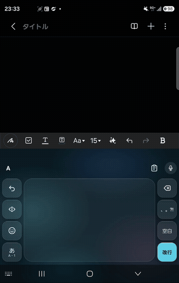
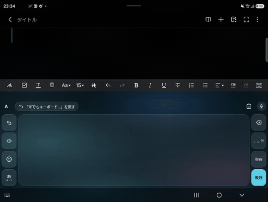

# イマジナリーフリック

キーを表示しない日本語キーボードです。
見えないテンキーを思い浮かべて、いつものフリックのつもりで打ちます。

- 読み取りも漢字の変換も、スマホの中だけで動きます
- インターネットの許可を持たないので、打った文字が外に送られることはありません

  
  

## ダウンロード

[Releases](../../releases/latest) から `imaginary-flick-<版>.apk` をダウンロードしてください。

## 動く機種

- Android 12L 以上
- 空き容量 300MB 以上、メモリ 6GB 以上が目安

## 入れ方

1. ダウンロードした APK を開く
2. 「この提供元のアプリを許可」と出たら許可して、「インストール」
3. アプリを開き、「はじめの準備」に沿って進める
   1. キーボードをオンにする
   2. イマジナリーフリックに切り替える
   3. 使い方を見る（約2分）

Android の注意文は、どのキーボードを入れても出る決まり文句です。

## コツ

- いつものテンキーの場所を思い浮かべて打ちます。大きさや位置が多少ずれても読み取れます
- 違う字になったら、帯の上の「よみ」の字を押して直せます
- 確定した直後なら、帯の「↶ 直す」で打ちかけに戻せます

## ご意見

「この言葉が出なかった」「ここが分かりにくい」などを [Issues](../../issues) か X で教えてください。打った文章そのものを送る必要はありません。

## プライバシー

- インターネットの許可を持たないため、打った文字を端末の外へ送ることはできません
- パスワード欄では、学習・候補・コピーの履歴を使いません
- 覚えた言葉と設定は端末の中だけに保存します。コピーの履歴はメモリにだけ持ち、1時間で消えます
- 音声入力（🎤）だけは、端末に入っている標準の音声認識を使います

## 免責

本アプリは試作版で、現状のまま無保証で提供します。
本アプリの利用、または利用できないことにより生じた損害について、作者は法令で認められる範囲で一切の責任を負いません。
パスワードやカード番号などの大切な情報は、ご自身の判断で入力してください。

## ライセンス

アプリ本体 © 2026 Shinya Ryu。無保証で提供します。
同梱しているモデル・辞書・ソフトウェアのライセンスは、アプリの「ライセンス」画面に載せています。
読み取りモデル kana-tap-small-pc1 は zenz-v3.1-small（© Keita Miwa、CC BY-SA 4.0）を追加学習したもので、CC BY-SA 4.0 で提供します。漢字の変換には zenz-v3.1-xsmall（© Keita Miwa、CC BY-SA 4.0）を GGUF に変換してそのまま使っています。モデルは APK の assets/models/ に入っています。
